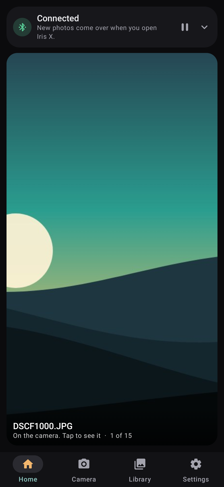
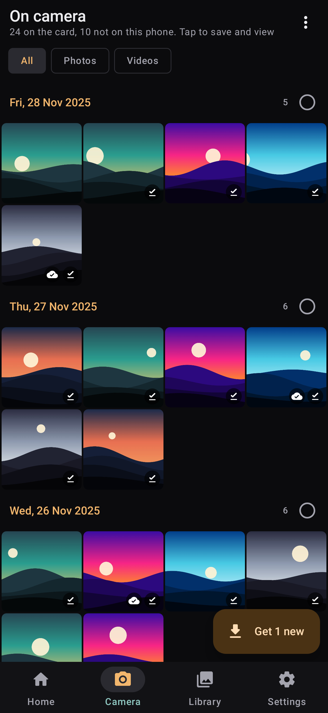
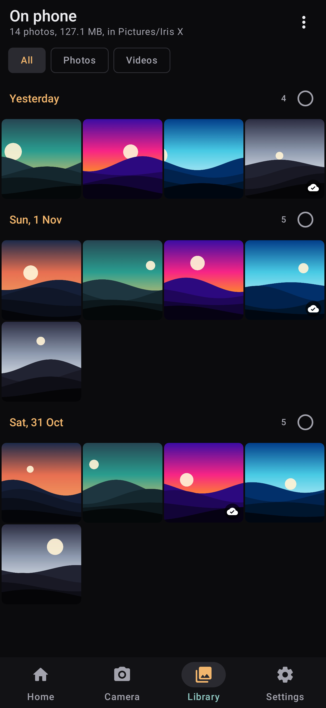
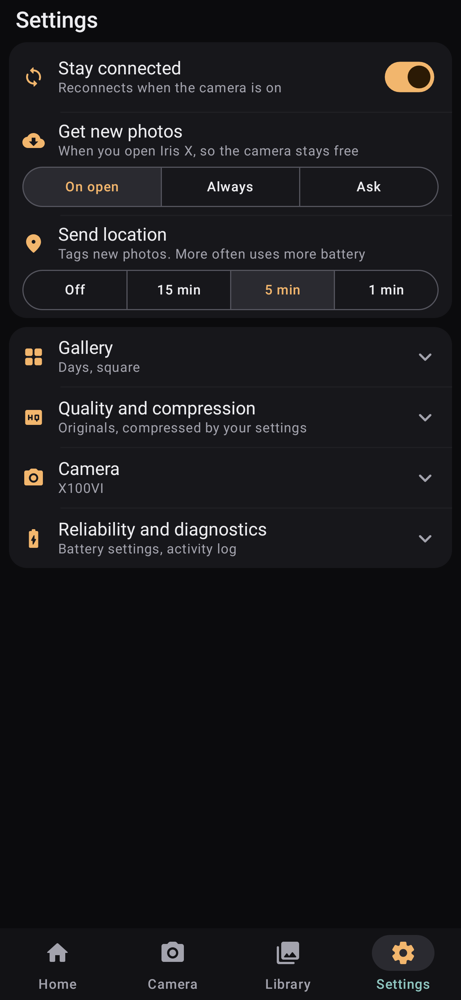
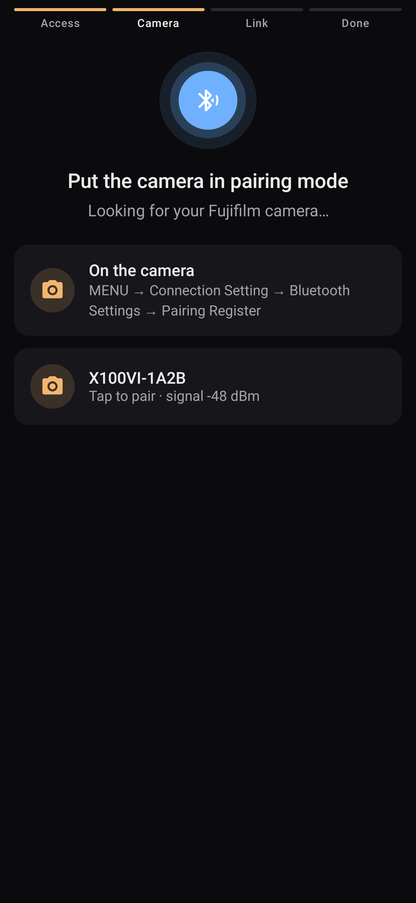

# Iris X

**An unofficial companion app for the Fujifilm X100VI camera.** You shoot, and your Android phone takes care of the rest: location tags, photo transfer, browsing the card, compression and backup.

> **Unofficial.** Iris X is an independent project, not affiliated with or endorsed by Fujifilm. Fujifilm and X100VI are trademarks of their owner.
>
> **Tested only with the Fujifilm X100VI.** Other cameras may or may not work.

## Screenshots

| Home | Camera | Library |
| --- | --- | --- |
|  |  |  |

| Settings | Pairing |
| --- | --- |
|  |  |

These images come from the app's real screens, using invented photos and mock data.

## Features

- **Location tagging:** shares your phone's location with the camera, so new photos get GPS coordinates and the right time.
- **Automatic connection:** reconnects over Bluetooth Low Energy when the camera is on, and uses Wi-Fi only for transfers and browsing.
- **Automatic transfer:** copies new JPEGs from the camera to your phone, into `Pictures/Iris X`.
- **Browse the card:** see the card's photos and videos by date, with thumbnails cached for offline viewing and marks for what is already on your phone.
- **Choose what to download:** get only the new photos, a selection or everything, with per-photo progress.
- **Full-screen viewer:** swipe between photos, zoom in, and see the camera's preview until the original arrives.
- **Google Photos backup:** queue photos in a device folder that Google Photos can back up, with no account in Iris X.
- **Photo compression:** shrink photos to a target size, by percentage or with your own settings, and compare the result before saving. Location and shooting details are kept.
- **Video:** download videos on request, play them in the app and make a smaller copy.
- **Connection help:** tells you when Bluetooth or Wi-Fi is off, and offers a way to turn it on.
- **Filters and selection:** filter by photos or videos, and press and hold to select several at once.

## What Iris X will not do

- **Delete from your camera:** the camera is read-only, and Delete only removes the phone's copy.
- **Download RAW files:** they are listed but not downloaded.
- **Send your photos to a server:** Iris X has no server or account. Photos only leave your phone through Google Photos or an app you share them with.

## Requirements

- An Android phone running Android 12 or later, with Bluetooth and Wi-Fi
- A Fujifilm X100VI

## Pairing

1. Open Iris X and allow the permissions it asks for.
2. On the camera, go to **MENU → Connection Setting → Bluetooth Settings → Pairing Register**.
3. Tap your camera in Iris X, then confirm on the camera.

## Build

Requires JDK 17 or later and the Android SDK.

```sh
./gradlew :app:assembleDebug
```

To regenerate the screenshots:

```sh
IRISX_SCREENSHOTS=1 ./gradlew :feature:home:testDebugUnitTest --tests "*ReadmeScreenshots*"
```
